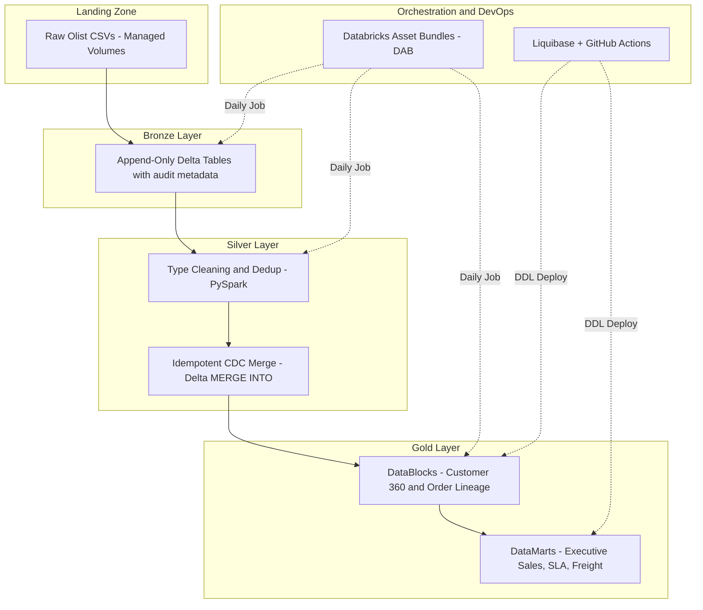
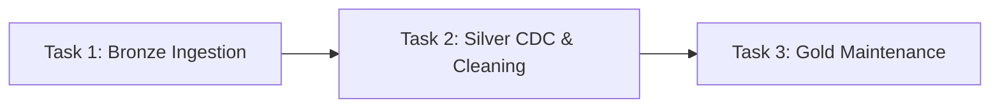
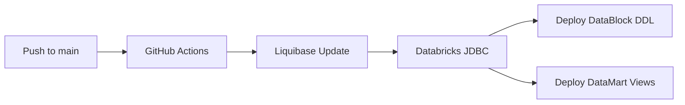

# Enterprise E-Commerce Lakehouse on Databricks & Delta Lake

[](https://github.com/ArinjoyNandy/ecommerce-lakehouse-databricks/actions/workflows/ci_tests.yml)
[](https://github.com/ArinjoyNandy/ecommerce-lakehouse-databricks/actions/workflows/liquibase_deploy.yml)
[](https://databricks.com/)
[](https://delta.io/)

A Medallion Lakehouse platform built on Databricks, Delta Lake, and PySpark using the Brazilian E-Commerce dataset. Features declarative GitOps change management via **Liquibase**, idempotent **CDC upsert merges**, and an isolated **DataBlock / DataMart** modeling contract.

---

## Architecture Overview



---

## Project Structure

```
ecommerce-lakehouse-databricks/
├── config/
│   ├── dev_config.json              # Dev environment configuration
│   └── prod_config.json             # Production environment configuration
├── notebooks/
│   ├── 01_bronze_ingest_runner      # Bronze: CSV → Delta ingestion
│   ├── 02_silver_cdc_runner          # Silver: Cleaning + CDC MERGE
│   └── 03_gold_maintenance_runner    # Gold: DDL, OPTIMIZE, VACUUM
├── src/
│   ├── bronze/
│   │   └── ingestion.py             # ingest_raw_csv_to_bronze()
│   ├── silver/
│   │   ├── cleaning.py               # clean_orders_data, clean_order_items_data, clean_customers_data
│   │   └── cdc_engine.py             # upsert_orders_silver (MERGE), overwrite_silver_table
│   ├── datablocks/
│   │   ├── mv_datablock_sales_order_lineage.sql
│   │   ├── mv_datablock_customer_360.sql
│   │   └── schema_changes/
│   │       ├── datablock.changelog.yml
│   │       └── CREATE_SCHEMA.sql
│   ├── datamarts/
│   │   ├── v_mart_daily_executive_sales.sql
│   │   ├── v_mart_logistics_regional_sla.sql
│   │   ├── v_mart_freight_leakage_analysis.sql
│   │   ├── v_mart_customer_segment_summary.sql
│   │   ├── v_mart_seller_fulfillment_efficiency.sql
│   │   ├── v_mart_temporal_demand_profile.sql
│   │   └── schema_changes/
│   │       └── datamart.changelog.yml
│   ├── maintenance/
│   │   └── refresh_and_optimize.sql   # OPTIMIZE ZORDER, ANALYZE, VACUUM
│   └── utils/
│       └── config_loader.py          # Environment config loader
├── tests/
│   ├── conftest.py                   # Pytest Spark session fixture
│   └── test_silver_cleaning.py       # Unit tests for Silver cleaning functions
├── workflows/
│   └── ecommerce_pipeline_job.json  # Databricks Job definition (3-task medallion chain)
├── .github/workflows/
│   └── liquibase_deploy.yml          # GitHub Actions: Liquibase DDL CI/CD for Gold layer
├── databricks.yml                   # Declarative Automation Bundle (DAB) config
├── requirements.txt
├── .gitignore
└── README.md
```

---

## Dataset

This project uses the **[Brazilian E-Commerce Public Dataset by Olist](https://www.kaggle.com/datasets/olistbr/brazilian-ecommerce)** (Kaggle). Raw CSVs are staged in a Unity Catalog volume at:

```
/Volumes/ecommerce_dev/bronze_stage/raw_landing/
```

### Ingested Tables

| Source CSV | Bronze Table | Records | Description |
| --- | --- | --- | --- |
| `olist_orders_dataset.csv` | `ecommerce_dev.bronze.raw_orders` | ~99,441 | Order lifecycle timestamps and status |
| `olist_order_items_dataset.csv` | `ecommerce_dev.bronze.raw_order_items` | ~112,650 | Line items with price and freight |
| `olist_customers_dataset.csv` | `ecommerce_dev.bronze.raw_customers` | ~99,441 | Customer IDs, city, state, zip code |

---

## Catalog & Schema Layout

| Catalog | Schema | Layer | Purpose |
| --- | --- | --- | --- |
| `ecommerce_dev` | `bronze` | Bronze | Raw append-only Delta tables with audit metadata |
| `ecommerce_dev` | `silver` | Silver | Type-cleaned, deduplicated, CDC-merged tables |
| `ecommerce_dev` | `gold` | Gold | Enriched DataBlock tables + DataMart reporting views |

### Silver Tables

| Table | Write Strategy | Key |
| --- | --- | --- |
| `ecommerce_dev.silver.orders` | Idempotent MERGE (CDC) | `order_id` |
| `ecommerce_dev.silver.order_items` | Full overwrite | `order_id` + `order_item_id` |
| `ecommerce_dev.silver.customers` | Full overwrite | `customer_id` |

### Gold DataBlocks (Materialized Tables)

| Table | Description |
| --- | --- |
| `ecommerce_dev.gold.datablock_sales_order_lineage` | Enriched order line-item lineage with SLA, financial, and geographic attributes |
| `ecommerce_dev.gold.datablock_customer_360` | Customer 360 with RFM segmentation and lifetime spend |

### Gold DataMarts (Reporting Views)

| View | Description |
| --- | --- |
| `v_mart_daily_executive_sales` | Daily KPIs: orders, revenue, freight, cancellations |
| `v_mart_logistics_regional_sla` | Regional fulfillment lead times and SLA breaches |
| `v_mart_freight_leakage_analysis` | Shipping cost burden ratio per product price tier |
| `v_mart_customer_segment_summary` | Customer count and spend by RFM cohort and region |
| `v_mart_seller_fulfillment_efficiency` | Seller fulfillment performance and transit times |
| `v_mart_temporal_demand_profile` | Day-of-week and weekend purchasing distributions |

---

## Pipeline Orchestration

The medallion pipeline is orchestrated as a 3-task Databricks Job:



| Task | Notebook | Description |
| --- | --- | --- |
| `task_bronze_ingestion` | `01_bronze_ingest_runner` | Reads raw CSVs from volumes, writes Bronze Delta tables |
| `task_silver_cdc_upsert` | `02_silver_cdc_runner` | Cleans data, applies CDC MERGE for orders, overwrites dimensions |
| `task_gold_maintenance` | `03_gold_maintenance_runner` | Refreshes gold DDL, runs OPTIMIZE ZORDER, ANALYZE, and VACUUM |

---

## CI/CD with Liquibase & GitHub Actions

Gold-layer schema changes are deployed via **Liquibase** triggered by GitHub Actions on every push to `main`:



- **Triggers**: Push to `main` on `src/datablocks/**`, `src/datamarts/**`, `src/maintenance/**`, or `.github/workflows/**`
- **Changelog files**: `datablock.changelog.yml` (creates DataBlock tables), `datamart.changelog.yml` (creates DataMart views)
- **Secrets required**: `DATABRICKS_JDBC_URL`, `DATABRICKS_TOKEN` (configured in GitHub repo settings)

---

## Testing

Unit tests for the Silver cleaning layer use pytest with a local Spark session:

```bash
# Run all tests
pytest tests/ -v

# Run a specific test
pytest tests/test_silver_cleaning.py -v
```

### Test Coverage

| Test | Validates |
| --- | --- |
| `test_clean_orders_filters_null_and_parses_dates` | Null `order_id` filtering, status normalization, timestamp parsing |
| `test_clean_order_items_handles_null_prices` | Null price/freight coalescing to `0.0` |

---

## Prerequisites

- **Databricks workspace** with Unity Catalog enabled
- **Serverless compute** or an interactive cluster with DBR 14.3+
- **Unity Catalog volume**: `ecommerce_dev.bronze_stage.raw_landing` populated with Olist CSVs
- **GitHub repo secrets** (for CI/CD): `DATABRICKS_JDBC_URL`, `DATABRICKS_TOKEN`
- **Python 3.10+** with packages from `requirements.txt`

---

## Getting Started

### 1. Stage raw data

Upload Olist CSVs to the Unity Catalog volume:

```bash
databricks fs cp olist_orders_dataset.csv /Volumes/ecommerce_dev/bronze_stage/raw_landing/
databricks fs cp olist_order_items_dataset.csv /Volumes/ecommerce_dev/bronze_stage/raw_landing/
databricks fs cp olist_customers_dataset.csv /Volumes/ecommerce_dev/bronze_stage/raw_landing/
```

### 2. Create catalog and schemas

```sql
CREATE CATALOG IF NOT EXISTS ecommerce_dev;
CREATE SCHEMA IF NOT EXISTS ecommerce_dev.bronze;
CREATE SCHEMA IF NOT EXISTS ecommerce_dev.silver;
CREATE SCHEMA IF NOT EXISTS ecommerce_dev.gold;
```

### 3. Run the pipeline

Run the notebooks in order, or trigger the Databricks Job:

1. `notebooks/01_bronze_ingest_runner` — ingests raw CSVs to Bronze Delta tables
2. `notebooks/02_silver_cdc_runner` — cleans and CDC-merges to Silver tables
3. `notebooks/03_gold_maintenance_runner` — creates/refreshes gold tables & views, runs maintenance

Alternatively, deploy and run via the DAB:

```bash
databricks bundle deploy --target dev
databricks bundle run ecommerce_medallion_pipeline --target dev
```

---

## Maintenance Operations

The `refresh_and_optimize.sql` script (run by the gold maintenance notebook) performs:

| Operation | Target Tables | Purpose |
| --- | --- | --- |
| `OPTIMIZE ... ZORDER BY` | Silver + Gold | File compaction and multidimensional clustering |
| `ANALYZE TABLE ... COMPUTE STATISTICS` | Gold DataBlocks | Cost-based optimizer statistics |
| `VACUUM ... RETAIN 168 HOURS` | Silver + Gold | Remove obsolete Delta versions (7-day retention) |

---

## Tech Stack

| Component | Technology |
| --- | --- |
| Compute | Databricks Serverless (Spark Connect) |
| Storage | Delta Lake on Unity Catalog volumes |
| Governance | Unity Catalog |
| Orchestration | Databricks Jobs (DAB-managed) |
| Schema Migrations | Liquibase + GitHub Actions |
| Testing | pytest + PySpark |
| Language | Python (PySpark) + SQL |